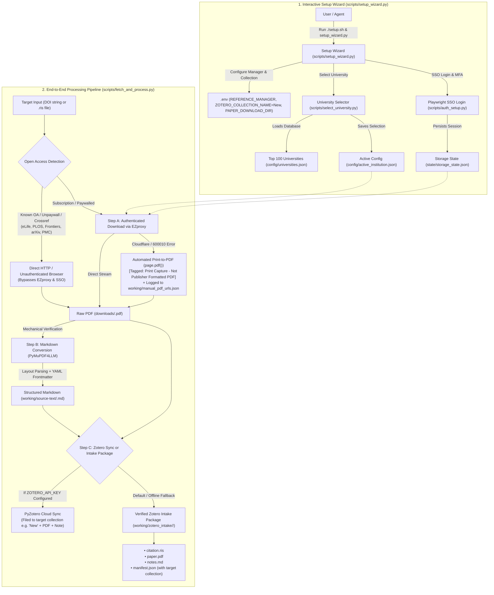

# Literature Research Skills

Portable skills for finding scientific papers, obtaining readable sources, and producing evidence-backed answers. Includes optional local MCP connector source, pinned Python dependencies, setup tools, and tests. **Mac-first; Python 3.12 for the optional tool stack.**

[Download a release](https://github.com/jstin777/literature-research-skills/releases) · [Installation](docs/install.md) · [Dependencies](docs/dependencies.md) · [Compatibility and validation](docs/compatibility.md)

## Choose what to install

| Skill | What it does | Activation |
| --- | --- | --- |
| [literature-search-review](skills/literature-search-review/SKILL.md) | Documented discovery, screening, citation tracing, source verification, and a compact handoff to a fresh writer | Subject-based paper searches |
| [paper-fulltext-access](skills/paper-fulltext-access/SKILL.md) | Direct LibKey recovery for a known paper; verifies actual readable content | Known-paper access and paywalls |
| [multi-agent-research-review](skills/multi-agent-research-review/SKILL.md) | Evidence mapping, independent advocate/adversarial evaluation, one cross-examination, synthesis and separate audits | **Explicit request only**; requires real agent delegation |

Install search and full-text access together for the integrated workflow. The access skill also works alone. Multi-agent review is optional and uses more model calls; no measured accuracy improvement is claimed.

**One repository, individual downloads.** All three skills have their own release ZIP. The skills-only plugin ZIP includes all three. The complete source bundle adds optional connectors and setup tools. This keeps one maintained version of each skill while letting recipients choose.

## Quick start in Codex on macOS

Download/extract the complete source ZIP, or clone this repository. Then, from its root:

```sh
python3 scripts/manage.py install-skills --dest "$HOME/.agents/skills"
```

This installs instructions and helper scripts, refuses overwrites, and leaves host settings alone. Do not also install the plugin ZIP with the same skills. Start a fresh chat if the skills do not appear.

Try:

> Use $literature-search-review to find five useful papers on urban tree cover and summer heat. Give me links, relevance and source-access labels; do not download files.

The host must already offer suitable search and source-reading tools. Skill instructions do not supply those capabilities. A missing fresh-context writer, browser control, account, or database must be disclosed. See [installation](docs/install.md) for the optional tool stack and other hosts.

## Optional connectors and external services

Included source: **OpenAlex**, **Semantic Scholar**, **PMC/Europe PMC full-text recovery**, and a **guarded Asta proxy** with timeouts, caching and explicit partial-recovery labels. Asta downloads its current tool schema during opt-in setup; the upstream schema and corpus are not redistributed.

Documented external integrations: **PubMed MCP**, **Scite MCP**, direct **LibKey**, browser/source-reading tools, and optional **Zotero–Obsidian**. See the [dependency matrix](docs/dependencies.md) and [connector setup](docs/connectors.md). Personal API keys, paid accounts and institutional access are not included. Public discovery remains usable without institutional subscriptions.

## Dynamic University Library Routing & Institutional Authentication

This repository supports dynamic institutional proxy routing across top universities worldwide (with preconfigured EZproxy prefixes and library portals in `config/universities.json`, including Vanderbilt University).

### Architecture & End-to-End Pipeline

The retrieval architecture is decoupled into a dedicated session manager and an end-to-end processing pipeline:



### Quick Setup

1. **Install Dependencies First (`./setup.sh`)**:
   Run the automated setup script from the repository root to create a Python virtual environment, install pinned dependencies, and register skill definitions:
   ```sh
   ./setup.sh
   ```

2. **Run the Interactive Setup Wizard (`scripts/setup_wizard.py`)**:
   Launch the onboarding wizard to configure your reference manager, target collection, university library SSO, and download paths:
   ```sh
   python3 scripts/setup_wizard.py
   # or convenience root entrypoint:
   python3 setup_wizard.py
   ```
   **What the wizard configures:**
   - **Reference Manager**: Select **Zotero** (with automated API cloud sync, PDF, and Markdown notes attachment), **Paperpile**, **Mendeley**, or **EndNote**. For Zotero, prompts for your User ID and API Key.
   - **Target Collection**: Prompts for your target Zotero collection name (defaulting to `"New"`). Newly processed papers are automatically filed directly into this collection.
   - **University Library & EZproxy SSO**: Selects your university from `config/universities.json` (e.g. Vanderbilt University) and launches a one-time interactive browser window to capture SSO/Duo session cookies into `state/storage_state.json`.
   - **Download Directory**: Saves your preferred paper storage path (defaulting to `downloads/`), saved to `PAPER_DOWNLOAD_DIR` in `.env`.

3. **Run the End-to-End Pipeline (Download → Markdown → Zotero)**:
   Retrieve papers, convert them into clean structured Markdown, and sync or package them directly into your target Zotero collection in a single step:
   ```sh
   # Process via target DOI (supports Wiley, Springer, HighWire, and Elsevier/ScienceDirect)
   python3 scripts/fetch_and_process.py --doi "10.1016/j.tics.2006.10.012"

   # Open Access DOIs (eLife, PLOS, Frontiers, arXiv, PMC) automatically bypass EZproxy
   python3 scripts/fetch_and_process.py --doi "10.1371/journal.pone.0210000"

   # Target a specific Zotero collection on the fly
   python3 scripts/fetch_and_process.py --doi "10.7554/elife.27798" --zotero-collection "Neuroscience"

   # Process via citation RIS file
   python3 scripts/fetch_and_process.py --ris "review/citations.ris"
   ```

   **Pipeline Stages:**
   - **Step A (Download & Automated Fallback)**: Automatically detects Open Access DOIs (eLife, PLOS, Frontiers, arXiv, PMC, BioMed Central, MDPI) and retrieves the PDF directly via HTTP/browser fetch bypassing EZproxy. For paywalled papers, uses your active institutional session to stream raw PDFs from publisher gateways into `downloads/` (or `$PAPER_DOWNLOAD_DIR`), verified via `source_files.py`. If direct PDF download is blocked by anti-bot barriers or proxy restrictions (e.g. ScienceDirect/Elsevier error `600010`), the pipeline falls back automatically without blocking on interactive prompts, rendering the article page via Playwright `page.pdf()`.
   - **Step B (Markdown Conversion)**: Employs `pymupdf4llm` to extract document structure, headers, and tables into `working/source-text/<doi>.md` with YAML frontmatter (including `is_print_fallback: true` when print capture is activated).
   - **Step C (Zotero Sync / Intake)**: If `ZOTERO_USER_ID` and `ZOTERO_API_KEY` are present in `.env`, automatically creates the Zotero library item in the target collection (specified by `ZOTERO_COLLECTION_NAME`, defaulting to `"New"`) and attaches both PDF and Markdown note. Otherwise, generates a verified offline intake package (`working/zotero_intake/<doi>/`) containing `citation.ris`, `paper.pdf`, `notes.md`, and `manifest.json`.

### Publisher Anti-Bot Defenses & Proxy Restrictions (Print-to-PDF Fallback & Manual Queue)

> [!NOTE]
> **Publisher Anti-Bot & Proxy Restrictions (ScienceDirect/Elsevier Error 600010 & Cloudflare Challenges)**:
> Automated retrieval of official journal-formatted PDFs can be blocked by publisher anti-bot challenges (such as Cloudflare Turnstile or hCaptcha) or institutional proxy restrictions on direct binary endpoints (specifically ScienceDirect/Elsevier error `600010` on `/pdfft` routes).
>
> When direct PDF download is blocked or returns an HTML challenge/error page, the pipeline falls back automatically without blocking on interactive browser prompts:
> 1. **Automated Print-to-PDF Fallback (`page.pdf()`)**: Playwright renders the accessible HTML article landing page in headless Chromium and exports it to a PDF via `page.pdf()`, allowing downstream Markdown conversion and reference manager intake to proceed without interruption.
> 2. **Clear Flagging & Titling**: The resulting document, metadata, Markdown frontmatter (`is_print_fallback: true`), and Zotero intake records/manifest are explicitly tagged with `[Print Capture - Not Publisher Formatted PDF]` to clearly distinguish them from official publisher-typeset PDFs.
> 3. **Manual Download Queue (`working/manual_pdf_urls.json` & `.txt`)**: Every article that falls back to a print capture is recorded into dedicated queue files containing the DOI, title, target article URL, and timestamp (deduplicated across repeat runs). This allows researchers to manually inspect or download the publisher-formatted PDF later if desired.

## What the workflow preserves

- Stable paper/evidence IDs, exact search/access events, deduplication, pending work and resumable checkpoints.
- Separate eligibility, identity verification, abstract access, full-text coverage, evidence verification, and download states.
- Original-source locations and access limits in the writer handoff; snippets and provider summaries do not become verified claims automatically.
- Explicit limits on database coverage, failed routes, partial sources and unprocessed pagination.
- Optional Zotero organization that keeps review candidates separate from selected reading intake; AI processing never assigns human reading status.

The release contains reusable source and synthetic test fixtures. It excludes personal notes, papers, library exports, credentials, cached responses and research history. This is a GitHub distribution, not a listing in a plugin marketplace.

## Development

```sh
python3.12 -m venv .venv
.venv/bin/python -m pip install -r requirements/dev.txt
.venv/bin/python scripts/test.py
.venv/bin/python scripts/smoke.py
.venv/bin/python scripts/check_release.py
.venv/bin/python scripts/build_release.py
```

Offline tests use synthetic records and mocked network responses. `smoke.py --live` makes a few public-provider calls; it is not an end-to-end literature review. See [maintenance](docs/maintenance.md) for release, backup and uninstall instructions.

MIT for original code and documentation. Dependencies and external services retain their own licenses and terms; see [third-party notices](THIRD_PARTY_NOTICES.md).

## Future Directions

### 1. Dedicated Local PDF-to-Markdown Extraction Pipeline
- **Deterministic Structural Parsing:** Replace raw `pypdf` text dumping with a local layout-aware parser (e.g., PyMuPDF layout analysis, Microsoft `markitdown`, or `marker`) to preserve document hierarchy (`#` title, `##` sections), multi-column reading flow, and reference lists.
- **Tabular & Figure Extraction:** Automatically extract data tables into standard Markdown grid tables and convert caption blocks into structured Markdown quotes to prevent hallucinated numbers during extraction audits.
- **Cost & Token Optimization:** Index clean Markdown artifacts locally instead of feeding multi-megabyte PDFs or unformatted text blocks to agent context windows.

### 2. Multi-Model and Multi-Host Portability
- **Beyond OpenAI Spec:** Decouple skill declarations from OpenAI-specific agent configurations (`openai.yaml`) by providing native definitions for Anthropic Claude (Model Context Protocol / MCP tool specs) and Google Gemini (Gemini CLI / Workspace agent manifests).
- **Standardized Execution Boundary:** Ensure system prompt contracts, tool calls, and handoff protocols execute consistently regardless of the underlying foundation model.

### 3. Local Retrieval & Hybrid Search Integration
- **Hybrid Retrieval (BM25 + Dense Embeddings):** Enable fast local vector and keyword indexing over converted markdown files in `search-records/` and `working/` for large corpora.
- **Chunk-Level Sourcing:** Allow the writer and audit agents to retrieve specific sub-sections or page locators without reading whole-paper bodies into active memory.

### 4. Automated Reference Manager Synchronization
- **Direct Zotero / Obsidian Bridge:** Automate the movement of included papers from the staging directory into Zotero collections via the Zotero Web API/local translation server, writing linked markdown literature notes directly into designated Obsidian vaults.
- **Bi-directional Annotations:** Extract highlighted PDF annotations and reader notes back into the `working/evidence.jsonl` record schema.
### 5. Reference Manager Expansion
- **Expanded Compatibility:** Add compatibility with other reference/citation managaers such as Paperpile, Mendeley, and EndNote.
  - **Zotero**: Free, open-source platform with robust community plugins and an excellent web clipper, but offers limited free cloud storage (300 MB) requiring paid upgrades for heavy PDF libraries.
  - **Paperpile**: Strong integration across Google workspace (e.g. Google Docs, Google Drive, etc) and may be better suited for Gemini-based workflows, but requires paid subscription
  - **Mendeley**: Built-in PDF annotation tools and literature recommendation features, but comes with corporate-owned data privacy concerns and a historically heavier desktop app.
  - **EndNote**: Industry standard for massive multi-thousand-reference libraries with complex journal styles, but is expensive proprietary software with a steep learning curve and dated interface.
### 6. README.md Visualization
- Add visualizations of workflow to the readme.md
